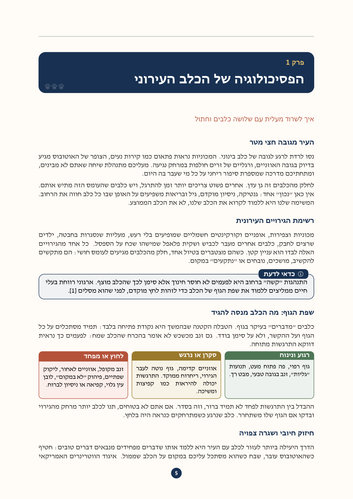
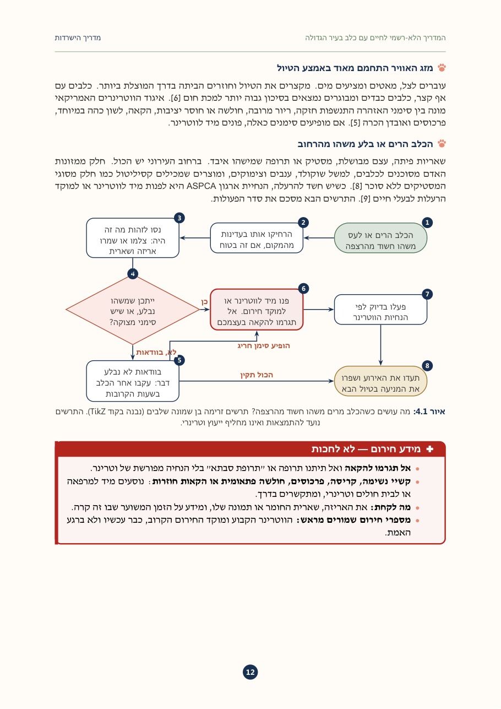

# המדריך הלא-רשמי לחיים עם כלב בעיר הגדולה
**בין פחמימות לטיולי לילה: המדריך השלם לבעלי כלבים עירוניים**

A 13-page illustrated Hebrew handbook for city dog owners, typeset in XeLaTeX, with every graphic
generated from code. A three-agent Claude Code team (MASTER, DETECTOR, FIXER) produced it as a
Vibe Coding academic project.

📕 **Final book:** [`output/final_book.pdf`](output/final_book.pdf)

<p align="center">
  
  
  
</p>

> All screenshots are rendered from the actual `output/final_book.pdf` by
> `scripts/generate_readme_images.py` (PyMuPDF). They are not mock-ups.

## Project status
| | |
|---|---|
| Book | ✅ compiles, 13 / 20 pages, all mandatory elements present |
| RTL check | ✅ whole-book audit: 0 reversed of 1,830 word pairs (`scripts/audit_rtl_full.py`) + 25/25 targeted probes |
| Source audit (FIXER) | ⏳ pending, FIXER session not yet started |
| Independent QA (DETECTOR) | ⏳ pending, DETECTOR session not yet started |
| Live 3-agent communication | ⏳ pending (see [AGENT_COMMUNICATION](docs/AGENT_COMMUNICATION.md)) |
| Report PDF (instructor template) | ⛔ template not provided |

Details are in [`docs/FINAL_CHECKLIST.md`](docs/FINAL_CHECKLIST.md).

## The book
| # | Chapter | Highlights |
|---|---|---|
| 1 | הפסיכולוגיה של הכלב העירוני: *איך לשרוד מעלית עם שלושה כלבים וחתול* | body-language panel, elevator scene (TikZ), elevator etiquette |
| 2 | מיפוי שטח: *הגיאוגרפיה של גינות כלבים ופינות הצל הנכונות* | Python-drawn neighborhood map, comparison table of 5 walking environments |
| 3 | לוגיסטיקה ואופרציות: *איך לארגן את התיק לטיול של חמש דקות שנגמר בשעה* | gear checklist, formula $T_{daily}=\sum t_i$, matplotlib graph |
| 4 | מדריך הישרדות: *שאלות נפוצות ותקלות נפוצות* | FAQ, 8-block decision flowchart, emergency box |

The book also contains a cover, an abstract (תקציר), an automatic TOC, an introduction, a bibliography (biblatex/biber), visual credits and a production note.

<p align="center">
  
  
</p>

### Code-generated graphics
| Graphic | Source | Technique |
|---|---|---|
| Cover city scene + elevator scene | `figures/tikz/dog_illustration.tex` | TikZ `pics` built from ellipses, circles, Bézier paths |
| Neighborhood planning map | `figures/python/create_illustration.py` | matplotlib patches (Rectangle, Circle, Polygon…) |
| Walk-time graph (illustrative data) | `figures/python/create_graph.py` | matplotlib, vector PDF |
| 8-block flowchart | `figures/tikz/eight_block_diagram.tex` | TikZ nodes + arrows |

## The three agents
| Agent | Skill | Responsibility |
|---|---|---|
| **MASTER** | [`/book-master`](.claude/skills/book-master/SKILL.md) | PRD, writing, LaTeX, graphics, build, triage, final acceptance |
| **DETECTOR** | [`/book-detector`](.claude/skills/book-detector/SKILL.md) | independent QA / red team on sources + rendered PDF; only it marks issues VERIFIED |
| **FIXER** | [`/book-fixer`](.claude/skills/book-fixer/SKILL.md) | source verification; implements approved fixes; requests retest |

```
student prompts ─► MASTER ──QA_REQUEST──► DETECTOR ──ISSUE_REPORT──► MASTER (triage)
                     │                        ▲                          │
                     └──FIX_REQUEST──► FIXER ─┴──RETEST_REQUEST          │
                                                   shared Git repository = source of truth
```
Architecture: [`docs/ARCHITECTURE.md`](docs/ARCHITECTURE.md) · protocol and log: [`docs/AGENT_COMMUNICATION.md`](docs/AGENT_COMMUNICATION.md)

## Vibe Coding process
Natural-language prompts → generated code → **run** → **inspect output** → refine. Real examples
from this project, each found by running and inspecting the output:
- The LaTeX prototype exposed a package-order error (biblatex before polyglossia) before the full book was written.
- A hand-written RTL helper double-reversed matplotlib's Hebrew text. matplotlib 3.11 already handles bidi, so the helper was removed.
- TikZ node text proved to be LTR under bidi. Visual checking was unreliable, so the project gained an automated position-based RTL probe.

See [`docs/PROMPT_HISTORY.md`](docs/PROMPT_HISTORY.md) and [`docs/PROCESS_LOG.md`](docs/PROCESS_LOG.md).

## Build
Prerequisites: Python ≥ 3.11, a TeX distribution with XeLaTeX + biber (developed on MiKTeX 25.12),
and the Windows fonts David, Gisha, Arial and Courier New.
```powershell
pip install -r requirements.txt
python scripts/build_book.py          # figures → xelatex → biber → xelatex ×2 → output/final_book.pdf
python scripts/check_rtl.py           # targeted RTL word-order probes
python scripts/audit_rtl_full.py      # whole-book RTL audit (source word pairs vs PDF)
python scripts/validate_project.py    # requirement checks → docs/VALIDATION_RESULTS.md
python scripts/generate_readme_images.py
```

## Repository
```
Master/ Detector/ Fixer/        agent role cards + work/ and reports/
.claude/skills/book-*/          the three Claude Code Skills
book/                           main.tex, preamble.tex, references.bib, frontmatter/, chapters/, backmatter/
figures/python | tikz | generated
scripts/                        build, validation, RTL probe, screenshots
docs/                           PRD, plan, architecture, logs, audit, QA, matrix, checklist
assets/readme/                  screenshots rendered from the PDF
output/final_book.pdf
```

## Documentation
[PRD](docs/PRD.md) · [Project plan](docs/PROJECT_PLAN.md) · [Requirements matrix](docs/REQUIREMENTS_MATRIX.md) ·
[Source audit](docs/SOURCE_AUDIT.md) · [QA report](docs/QA_REPORT.md) · [Issue tracker](docs/ISSUE_TRACKER.md) ·
[Self-assessment](docs/SELF_ASSESSMENT.md)

## Contributors
**ליה פורת ורוני ברק** · group code `liyaroni-ex2`. The content is informational and does not replace a veterinarian.
